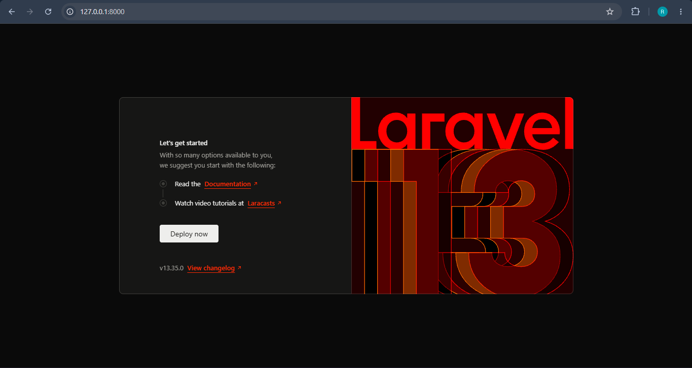

# TugasWeb-P9-LaravelSetup

## Tugas Rutin Pertemuan 9 - Pemrograman Web

Project ini dibuat untuk memenuhi Tugas Rutin Pertemuan 9 pada mata kuliah Pemrograman Web menggunakan framework Laravel.

## Deskripsi

Project menerapkan:
- Setup Laravel
- Konfigurasi database MySQL
- Routing
- Blade View
- Data dinamis dari Route
- Controller
- Model dan Migration

## Route

| URL | Fungsi |
|---|---|
| `/` | Halaman Home |
| `/about` | Halaman About |
| `/contact` | Halaman Contact |

## Instalasi

### 1. Clone Project

```bash
git clone <URL-REPOSITORY>
cd TugasWeb-P9-LaravelSetup

## Screenshot

